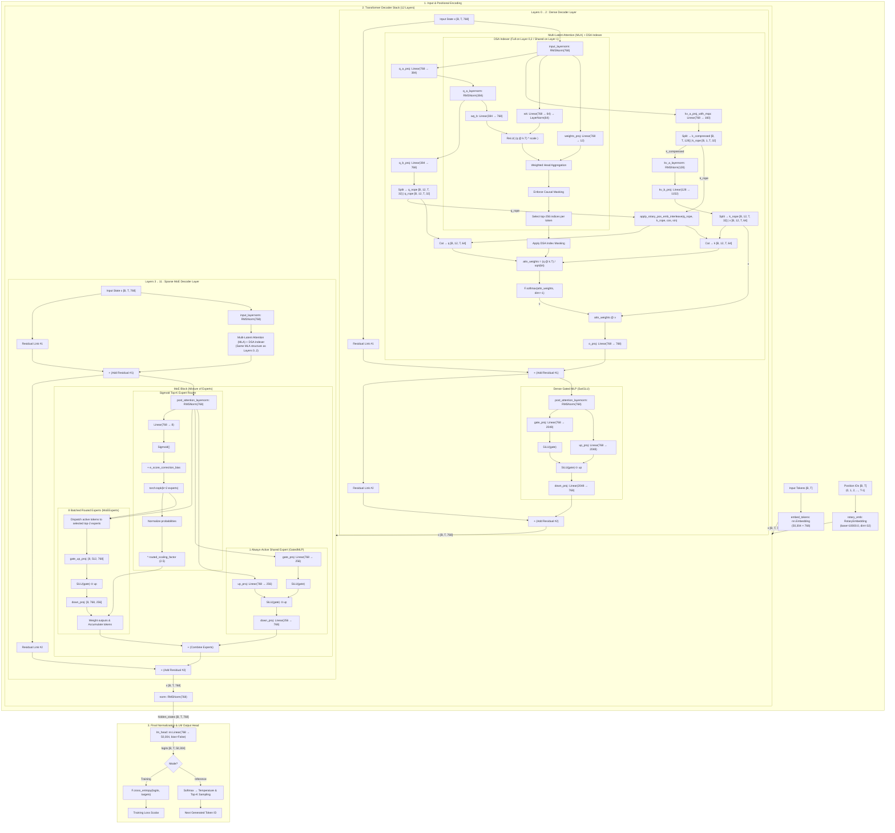

# Nano-GLM Project Knowledge Base

> **Project:** Nano-GLM — A baby (~120M parameter) reproduction of GLM-5.2 (GLM MoE DSA) trained from scratch.
> **Repository:** https://github.com/P1yansh/Nano-GLM.git

> **Last Updated:** 2026-09-08

> [!NOTE]
> This central knowledge base aggregates all architectural decisions, training runs, empirical loss trajectories, bug diagnoses, hardware optimizations, decoding ablation studies, and operational blueprints across all agent conversations on the Nano-GLM codebase.

---

## Table of Contents
1. [Hardware & Environment](#1-hardware--environment)
2. [Model Architecture](#2-model-architecture)
3. [Training History & Empirical Logs](#3-training-history--empirical-logs)
4. [Data Preparation & Pipelines](#4-data-preparation--pipelines)
5. [Decoding Engine & KV-Cache Architecture](#5-decoding-engine--kv-cache-architecture)
6. [Ablation Study](#6-ablation-study)
7. [GPU vs CPU Inference & Cloud Serving Investigation](#7-gpu-vs-cpu-inference--cloud-serving-investigation)
8. [GPU Power Throttling Discovery](#8-gpu-power-throttling-discovery)
9. [Code Changes Registry](#9-code-changes-registry)
10. [Bug Fixes & Regressions Registry](#10-bug-fixes--regressions-registry)
11. [Git History & Branch Registry](#11-git-history--branch-registry)
12. [Web UI & API Backend Architecture](#12-web-ui--api-backend-architecture)
13. [Key Technical Discoveries](#13-key-technical-discoveries)
14. [User Preferences & Rules](#14-user-preferences--rules)
15. [Repository File Map](#15-repository-file-map)
16. [Chat Contribution Records](#16-chat-contribution-records)
17. [Exhaustive Component-Level Architecture & Dataflow Specification](#17-exhaustive-component-level-architecture--dataflow-specification)

---

## 1. Hardware & Environment

### Machine
| Component | Spec |
|---|---|
| **Laptop** | Lenovo LOQ 15 (15ARP9), Model 83JC |
| **GPU** | NVIDIA GeForce RTX 4050 Laptop, 6 GB VRAM (6.4 GB allocated max), 2560 CUDA cores |
| **GPU TGP** | Default 55W, Performance Mode 95W, Absolute Max 105W |
| **Power Modes** | `Fn + Q` cycles: Blue (Quiet 50W) → White (Balanced 55W) → **Red (Performance 95W)** |
| **CPU** | AMD Ryzen (4.5+ GHz single-core, large L3 cache) |
| **OS** | Windows (PowerShell — use `;` not `&&` for command chaining) |
| **Filesystem Quirk** | Windows NTFS keeps active file handle locks during binary streaming; File Explorer reports `0 KB` until file handles are explicitly closed / flushed |

### Software Environment
| Component | Value |
|---|---|
| **Conda env** | `dl_4050_2` |
| **Run command** | `conda run -n dl_4050_2 python <script>` or direct executable invocation |
| **Python path** | `C:\Users\PIYANS~1\anaconda3\envs\dl_4050_2\python.exe` |
| **Tokenizer** | `tiktoken` (GPT-2 encoding, 50,257 vocab padded to 50,304) — **User directive: "keep tiktoken"** |
| **torch.compile** | Disabled — Triton is unsupported on Windows |
| **Framework** | PyTorch with `bfloat16` mixed precision on CUDA, `float32` on CPU |
| **Tensor Cores** | `torch.backends.cuda.matmul.allow_tf32 = True`, `torch.backends.cudnn.allow_tf32 = True` |

### Verified Dependency Manifest (`dl_4050_2`)
| Package | Installed Version | Constraint in `requirements.txt` | Purpose |
|---|---|---|---|
| `torch` | `2.7.1+cu118` | `>=2.1.0` | Core deep learning framework (CUDA 11.8 backend) |
| `numpy` | `2.2.6` | `>=1.24.0` | Data arrays & binary memmap token loading |
| `tiktoken` | `0.13.0` | `>=0.5.0` | GPT-2 fast Byte-Pair Encoding (BPE) tokenizer |
| `tqdm` | `4.67.3` | `>=4.65.0` | Progress bars and throughput tracking |
| `filelock` | `3.25.2` | — | Cache lock management for model weights |
| `typing-extensions`| `4.15.0` | `>=4.10.0` | Type annotations |
| `sympy` | `1.14.0` | `>=1.13.3` | Symbolic math (PyTorch dependency) |
| `networkx` | `3.4.2` | — | Computation graph structures |
| `jinja2` | `3.1.6` | — | Templating engine (PyTorch dependency) |
| `fsspec` | `2026.2.0` | — | Filesystem abstractions |
| `regex` | `2026.5.9` | — | High-performance regex (tiktoken engine) |
| `requests` | `2.33.1` | — | Checkpoint and dataset streaming |
| `colorama` | `0.4.6` | — | Terminal formatting |

### Windows OS, Shell & Tooling Execution Quirks
1. **PowerShell Call Operator (`&`) with Quoted Paths:**
   - In Windows PowerShell, running a quoted path like `"C:\path\python.exe" -c "..."` throws `ParserError: Unexpected token '-c' in expression or statement`.
   - *Requirement:* Always prepend the PowerShell invocation operator `&`: `& 'C:\Users\Piyansh shukla\anaconda3\envs\dl_4050_2\python.exe' <args>`.
2. **Conda CLI Subprocess Multi-line Bug (`AssertionError` in `conda\utils.py`):**
   - Executing inline scripts with line breaks via `conda run -n dl_4050_2 python -c "..."` crashes on Windows: `AssertionError: Support for scripts where arguments contain newlines not implemented` at line 451 of `conda\utils.py`.
   - *Resolution:* Either keep inline commands on a single semicolon-delimited line, save complex logic to a `.py` file, or invoke the conda environment's `python.exe` binary directly.
3. **VS Code Pylance Workspace Binding:**
   - If `.vscode/settings.json` is missing `"python.defaultInterpreterPath"`, VS Code's Pylance language server falls back to base or system Python where `torch` and `tiktoken` are absent, displaying 8 error squiggles (`reportMissingImports`).
   - *Fix applied:* Configured workspace setting:
     ```json
     {
         "python.defaultInterpreterPath": "C:\\Users\\Piyansh shukla\\anaconda3\\envs\\dl_4050_2\\python.exe",
         "python-envs.defaultEnvManager": "ms-python.python:conda",
         "python-envs.defaultPackageManager": "ms-python.python:conda"
     }
     ```

---

## 2. Model Architecture

### Overview
Baby GLM-5.2 combining three cutting-edge innovations from DeepSeek-V3 and GLM-5:
1. **MLA (Multi-Latent Attention)** — LoRA-compressed Q and KV projections
2. **DSA (DeepSeek Sparse Attention)** — Top-k token selection via learned indexer
3. **MoE (Mixture of Experts)** — Sigmoid-routed fine-grained experts + shared expert

### Parameter Count Breakdown & Sizing Analysis

A critical architectural distinction in `train_glm5.py` is the `tie_word_embeddings` flag in `GLM5Config`, which governs whether the output `lm_head` shares weights with the input `embed_tokens`:

| Metric | Untied Embeddings (`tie_word_embeddings = False`) | Tied Embeddings (`tie_word_embeddings = True`) | Notes |
|---|---|---|---|
| **Input Embeddings (`embed_tokens`)** | 50,304 × 768 = **38,633,472** | 50,304 × 768 = **38,633,472** | Token ID → 768-dim vector lookup |
| **Output Head (`lm_head`)** | 50,304 × 768 = **38,633,472** | **0** (Shared with `embed_tokens`) | Hidden state → 50,304 logits |
| **Total Vocab Parameters** | **77,266,944** (~77.3M) | **38,633,472** (~38.6M) | Pure lookup tables (0 compute) |
| **Non-Embedding Parameters** | **81,532,416** (~81.5M) | **81,532,416** (~81.5M) | **Identical across both configurations** |
| **Total Model Parameters** | **158,799,360** (~158.8M) | **120,165,888** (~120.2M) | Explains the 120M vs. 159M citations |
| **Active per Token** | 126,948,864 (~126.9M) | **88,315,392** (~88.3M) | Embed + Dense + Shared + 2 Active Experts |

> [!NOTE]
> The non-embedding parameter count (**81,532,416**) is the exact same in both configurations. AI researchers evaluate true reasoning and compute capacity using **non-embedding parameters**, as vocabulary expansion inflates total parameters without adding compute or reasoning depth.

### Exact Component-by-Component Parameter Derivation (Empirically Verified)

The exact parameter count for every single sub-module in Nano-GLM was empirically calculated and verified via direct tensor inspection:

#### 1. Base MLA Attention Sublayer (Per Layer: 1,450,496 params)
* `q_a_proj`: Linear(768 → 384, bias=False) = $768 \times 384 = \mathbf{294,912}$
* `q_a_layernorm`: RMSNorm(384) = $\mathbf{384}$
* `q_b_proj`: Linear(384 → 12 × 64 = 768, bias=False) = $384 \times 768 = \mathbf{294,912}$
* `kv_a_proj_with_mqa`: Linear(768 → 128 + 32 = 160, bias=False) = $768 \times 160 = \mathbf{122,880}$
* `kv_a_layernorm`: RMSNorm(128) = $\mathbf{128}$
* `kv_b_proj`: Linear(128 → 12 × (32 + 64) = 1152, bias=False) = $128 \times 1152 = \mathbf{147,456}$
* `o_proj`: Linear(12 × 64 = 768 → 768, bias=False) = $768 \times 768 = \mathbf{589,824}$

#### 2. DSA Indexer Sublayer (On 6 Full Layers: 0, 2, 4, 6, 8, 10: 353,408 params)
* `wq_b`: Linear(384 → 12 × 64 = 768, bias=False) = $384 \times 768 = \mathbf{294,912}$
* `wk`: Linear(768 → 64, bias=False) = $768 \times 64 = \mathbf{49,152}$
* `k_norm`: LayerNorm(64) = $64 \text{ (weight)} + 64 \text{ (bias)} = \mathbf{128}$
* `weights_proj`: Linear(768 → 12, bias=False) = $768 \times 12 = \mathbf{9,216}$
* *Shared Indexer layers (1, 3, 5, 7, 9, 11) have 0 indexer parameters (they reuse the previous layer's top-k index tensor).*

#### 3. Layer Normalization (Per Layer: 1,536 params)
* `input_layernorm`: RMSNorm(768) = $\mathbf{768}$
* `post_attention_layernorm`: RMSNorm(768) = $\mathbf{768}$

#### 4. Feed-Forward Networks (Dense vs. MoE)
* **Dense SwiGLU MLP (Layers 0, 1, 2):**
  * `gate_proj`: Linear(768 → 2048, bias=False) = $768 \times 2048 = 1,572,864$
  * `up_proj`: Linear(768 → 2048, bias=False) = $768 \times 2048 = 1,572,864$
  * `down_proj`: Linear(2048 → 768, bias=False) = $2048 \times 768 = 1,572,864$
  * *Total per Dense Layer:* $\mathbf{4,718,592}$
* **MoE Block (Layers 3 through 11 — 9 layers):**
  * TopKRouter `weight`: Parameter(8, 768) = $\mathbf{6,144}$
  * 8 Routed Experts (`MoEExperts` batched 3D parameter tensors):
    * `gate_up_proj`: Parameter(8, 2 × 256, 768) = $8 \times 512 \times 768 = 3,145,728$
    * `down_proj`: Parameter(8, 768, 256) = $8 \times 768 \times 256 = 1,572,864$
    * *Routed Experts Subtotal:* $4,718,592$
  * 1 Shared Expert (`GatedMLP`):
    * `gate_proj` ($768 \times 256 = 196,608$) + `up_proj` ($768 \times 256 = 196,608$) + `down_proj` ($256 \times 768 = 196,608$) = $589,824$
  * *Total per MoE Layer:* $6,144 + 4,718,592 + 589,824 = \mathbf{5,314,560}$

#### 5. Per-Layer Aggregation Matrix
| Layer Index | Layer Type | Indexer Type | Attention Params | FFN / MoE Params | RMSNorm Params | Total Layer Params |
|---|---|---|---|---|---|---|
| **Layer 0** | Dense | Full | 1,803,904 | 4,718,592 | 1,536 | **6,524,032** |
| **Layer 1** | Dense | Shared | 1,450,496 | 4,718,592 | 1,536 | **6,170,624** |
| **Layer 2** | Dense | Full | 1,803,904 | 4,718,592 | 1,536 | **6,524,032** |
| **Layer 3** | Sparse MoE | Shared | 1,450,496 | 5,314,560 | 1,536 | **6,766,592** |
| **Layer 4** | Sparse MoE | Full | 1,803,904 | 5,314,560 | 1,536 | **7,120,000** |
| **Layer 5** | Sparse MoE | Shared | 1,450,496 | 5,314,560 | 1,536 | **6,766,592** |
| **Layer 6** | Sparse MoE | Full | 1,803,904 | 5,314,560 | 1,536 | **7,120,000** |
| **Layer 7** | Sparse MoE | Shared | 1,450,496 | 5,314,560 | 1,536 | **6,766,592** |
| **Layer 8** | Sparse MoE | Full | 1,803,904 | 5,314,560 | 1,536 | **7,120,000** |
| **Layer 9** | Sparse MoE | Shared | 1,450,496 | 5,314,560 | 1,536 | **6,766,592** |
| **Layer 10** | Sparse MoE | Full | 1,803,904 | 5,314,560 | 1,536 | **7,120,000** |
| **Layer 11** | Sparse MoE | Shared | 1,450,496 | 5,314,560 | 1,536 | **6,766,592** |
| **All 12 Layers** | — | — | **19,526,400** | **61,986,816** | **18,432** | **81,531,648** |
| **Final RMSNorm**| — | — | — | — | **768** | **768** |
| **Total Non-Embedding** | — | — | — | — | — | **81,532,416** |

### Embedding vs. Non-Embedding Parameters: Theoretical Foundations
1. **The Vocabulary Inflation Effect:**
   - Embedding matrices are $O(1)$ dictionary lookup tables: looking up token ID `17431` retrieves the corresponding 768-dimensional float vector directly from memory. No matrix multiplications or activations occur.
   - Expanding vocabulary from 50k to 150k adds ~77M parameters to the model, but adds **zero reasoning, logic, or contextual computation**.
   - Model capacity is therefore measured by **non-embedding parameters** (81.5M).
2. **Initial State of the 768 Hidden Dimensions:**
   - At Step 0, weights are initialized from a normal distribution $\mathcal{N}(0, 0.02^2)$ (`initializer_range = 0.02`).
   - The initial 768 coordinates are random Gaussian noise without semantic alignment.
   - Through pre-training backpropagation, these 768 coordinates organize into a continuous geometric manifold where similar semantic concepts cluster and vector arithmetic holds ($v_{\text{king}} - v_{\text{man}} + v_{\text{woman}} \approx v_{\text{queen}}$).
3. **Production Freezing & Autograd Stoppage (`torch.no_grad()`):**
   - In production serving, the embedding table and layer weights are static.
   - Running under `@torch.no_grad()` and `model.eval()` instructs PyTorch not to build dynamic computation graphs or store activation tensors for backpropagation. This slashes inference VRAM consumption by **>50%** and eliminates backward pass bookkeeping latency.

### Configuration (`GLM5Config` — `train_glm5.py`)

```python
vocab_size           = 50304    # GPT-2 (50,257) padded to nearest 128 for Tensor Core alignment
hidden_size          = 768      # Model width (d_model)
num_hidden_layers    = 12       # Total decoder layers

# Multi-Latent Attention (MLA)
num_attention_heads  = 12       # Query heads
q_lora_rank          = 384      # Query LoRA bottleneck (768 -> 384 -> 12 * 64)
kv_lora_rank         = 128      # KV LoRA bottleneck (768 -> 160 -> split 128 latent + 32 RoPE)
qk_nope_head_dim     = 32       # Non-rotary Q/K head dim
qk_rope_head_dim     = 32       # Rotary Q/K head dim
v_head_dim           = 64       # Value head dim
qk_head_dim          = 64       # nope (32) + rope (32)

# Dense MLP
intermediate_size    = 2048     # Dense SwiGLU FFN intermediate dim
hidden_act           = "silu"   # SiLU/SwiGLU activation

# Mixture of Experts (MoE)
first_k_dense_replace = 3       # Layers 0–2 use dense MLP; Layers 3–11 use MoE
moe_intermediate_size = 256     # Per-expert FFN intermediate dim
n_routed_experts      = 8       # Routed experts
num_experts_per_tok   = 2       # Top-2 sigmoid routing per token
n_shared_experts      = 1       # Always-active shared expert (dim = 256)
routed_scaling_factor = 2.5     # Expert weight scaling factor
norm_topk_prob        = True    # Normalize routing probabilities

# DeepSeek Sparse Attention (DSA)
index_topk           = 256      # Top tokens selected by DSA indexer
index_head_dim       = 64       # Head dim in DSA indexer
index_n_heads        = 12       # Heads in DSA indexer
# Indexer pattern: FSFSFSFSFSFS (Full/Sparse alternating across 12 layers)

# Positional Encoding
max_position_embeddings = 4096  # Max context length
rope_theta              = 10000.0

# Regularization & Initialization
rms_norm_eps         = 1e-5
attention_dropout    = 0.0      # 0.0 because modern LLM pretraining uses large datasets
initializer_range    = 0.02
tie_word_embeddings  = True
```

### Layer Structure & Routing Details
- **Layers 0–2:** Dense SwiGLU MLP (`gate_proj`, `up_proj`, `down_proj` of dim 2048).
- **Layers 3–11:** MoE (8 routed experts via Top-2 sigmoid router + 1 shared expert).
- **All layers:** MLA attention with compressed KV + DSA sparse indexing.
- **Indexer Pattern:** `FSFSFSFSFSFS` — Even layers (0, 2, 4, 6, 8, 10) run fresh indexer scoring; odd layers (1, 3, 5, 7, 9, 11) share and reuse the previous layer's top-k indices.
- **MoE dispatch:** Fused 3D parameter tensors (`gate_up_proj [8, 512, 768]`, `down_proj [8, 768, 256]`), one-hot dispatch masks, and `index_add_` accumulation.

### MLA KV-Cache Compression vs Traditional Attention
Traditional multi-head attention caches $2 \times H \times D = 2 \times 12 \times 64 = 1{,}536$ floats per token per layer.
MLA caches only the compressed latent vector ($128$) + shared rotary key ($32$) = **160 floats per token per layer**, delivering a **4.8× reduction in KV cache memory**.

---

## 3. Training History & Empirical Logs

### Phase 1+2: Initial Pre-Training (COMPLETED)
| Parameter | Value |
|---|---|
| **Steps** | 0 → 270,000 |
| **Tokens Trained** | **~2.49 Billion tokens** ($270{,}000 \times 9{,}216\text{ tok/step}$) |
| **Datasets** | FineWeb-Edu, Wikipedia, Project Gutenberg, StarCoder (`./data`) |
| **Starting Loss** | `10.9804` (random init near theoretical $\ln(50304) \approx 10.82$) |
| **Mid-Training Loss** | `4.0523` at step 126,000 (stable plateau) |
| **Final Val Loss** | **`3.3716`** (ckpt_best.pt at step 270,000, Perplexity `~29.18`) |
| **Optimizer** | AdamW ($\beta_1=0.9, \beta_2=0.95$, weight_decay=0.1) |
| **Learning Rate Schedule** | WSD: Warmup 0→1.5k (`0` to `6e-4`), Stable 1.5k→217k (`6e-4` flat), Cosine Decay 217k→260k (`6e-4` to `6e-5`) |
| **Batch Config** | Micro-batch 6, Grad Accum 3, Seq Len 512 → **9,216 tokens/step** |
| **Gradient Clipping** | 1.0 |
| **Mixed Precision** | `bfloat16` on CUDA |
| **Gradient Checkpointing** | ON (saves ~40% VRAM, ~30% compute overhead) |
| **VRAM Usage** | **4.78 GB** continuously stable on RTX 4050 |
| **Throughput** | **4,700 – 4,900 tokens/sec** |

### Phase 3: Continued Pre-Training (CPT) (COMPLETED)
| Parameter | Value |
|---|---|
| **Steps** | 270,001 → 324,300 (54,300 steps) |
| **Tokens Trained** | **~500 Million tokens** ($54{,}300 \times 9{,}216\text{ tok/step}$) |
| **Datasets** | Cosmopedia v2 (40%), Python Code (30%), OpenWebMath (15%), FineWeb-Edu Score 4+ (15%) |
| **Final Val Loss** | **`2.6220`** (Perplexity **13.76**) |
| **LR Schedule** | CPT Mini-WSD: Warmup 270k→271k (`3e-5` to `1.8e-4`), Stable 271k→305k (`1.8e-4`), Cosine Decay 305k→324.3k (`1.8e-4` to `3e-5`) |
| **Warmup Start Step** | `warmup_start_iter = 270000` (Eliminated LR jump discontinuity) |

### Key Validation Loss Milestones Across Full Training Run
| Step | Phase | Train Loss | Val Loss | Perplexity | Notes |
|---|---|---|---|---|---|
| 0 | Phase 1 | 10.9758 | 10.9804 | 58,711 | Random init |
| 2,000 | Phase 1 | 5.2606 | 5.2206 | 185.0 | End of linear warmup |
| 20,000 | Phase 1 | 4.2729 | 4.3073 | 74.2 | First stable checkpoint |
| 110,000 | Phase 1 | 4.0973 | 4.1019 | 60.5 | Deep stable exploration |
| 126,000 | Phase 1 | 4.0661 | **4.0523** | 57.5 | **Stable Phase Best Val Loss** |
| 150,000 | Phase 1 | 4.0720 | 4.0808 | 59.2 | Constant LR `6e-4` plateau |
| 217,000 | Phase 1 | 4.0600 | 4.0750 | 58.9 | **WSD Decay Phase Trigger Point** |
| 243,300 | Phase 2 | 3.8200 | 3.7500 | 42.5 | Mid-decay descent |
| 270,000 | Phase 2 | 3.2700 | **3.3716** | **29.12** | **Phase 1+2 Best Checkpoint (Early Stopped)** |
| 272,000 | Phase 3 CPT | 2.8003 | 2.9083 | 18.32 | First CPT evaluation |
| 274,000 | Phase 3 CPT | 2.8003 | 2.9197 | 18.53 | CPT stable phase |
| 322,000 | Phase 3 CPT | 2.5100 | **2.6220** | **13.76** | **All-Time Best Checkpoint** |

### Complete Raw Console Log Snippet (Steps 108,100 → 155,700)
```text
  [RESUME] Loading checkpoint from out_glm5\ckpt.pt...
  [RESUME] Resuming from step 108001 (best val loss: 4.0567)
  step 108100 | loss 4.0845 | lr 6.00e-04 | 4,473 tok/s | VRAM 4.78GB
  step 108200 | loss 3.9582 | lr 6.00e-04 | 4,278 tok/s | VRAM 4.78GB
  step 108300 | loss 4.2739 | lr 6.00e-04 | 4,482 tok/s | VRAM 4.78GB
  step 108400 | loss 4.0392 | lr 6.00e-04 | 4,555 tok/s | VRAM 4.78GB
  step 108500 | loss 4.0631 | lr 6.00e-04 | 4,196 tok/s | VRAM 4.78GB
  step 108600 | loss 3.9086 | lr 6.00e-04 | 4,241 tok/s | VRAM 4.78GB
  step 108700 | loss 4.2504 | lr 6.00e-04 | 4,081 tok/s | VRAM 4.78GB
  step 108800 | loss 3.9103 | lr 6.00e-04 | 4,293 tok/s | VRAM 4.78GB
  step 108900 | loss 3.8787 | lr 6.00e-04 | 4,801 tok/s | VRAM 4.78GB
  step 109000 | loss 3.9953 | lr 6.00e-04 | 4,838 tok/s | VRAM 4.78GB
  step 110000 | train 4.0973 | val 4.1019 | lr 6.00e-04
           [SAVED] latest checkpoint to out_glm5\ckpt.pt (step 110000)
  step 112000 | train 4.0804 | val 4.0733 | lr 6.00e-04
           [SAVED] latest checkpoint to out_glm5\ckpt.pt (step 112000)
  step 114000 | train 4.0706 | val 4.0742 | lr 6.00e-04
           [SAVED] latest checkpoint to out_glm5\ckpt.pt (step 114000)
  step 116000 | train 4.0990 | val 4.0813 | lr 6.00e-04
           [SAVED] latest checkpoint to out_glm5\ckpt.pt (step 116000)
  step 118000 | train 4.0732 | val 4.0761 | lr 6.00e-04
           [SAVED] latest checkpoint to out_glm5\ckpt.pt (step 118000)
  step 120000 | train 4.0885 | val 4.0763 | lr 6.00e-04
           [SAVED] latest checkpoint to out_glm5\ckpt.pt (step 120000)
  step 122000 | train 4.0562 | val 4.0905 | lr 6.00e-04
           [SAVED] latest checkpoint to out_glm5\ckpt.pt (step 122000)
  step 124000 | train 4.1116 | val 4.0891 | lr 6.00e-04
           [SAVED] latest checkpoint to out_glm5\ckpt.pt (step 124000)
  step 126000 | train 4.0661 | val 4.0523 | lr 6.00e-04
           [SAVED] latest checkpoint to out_glm5\ckpt.pt (step 126000)
           [SAVED] BEST checkpoint to out_glm5\ckpt_best.pt (val_loss=4.0523)
  step 128000 | train 4.1063 | val 4.0675 | lr 6.00e-04
           [SAVED] latest checkpoint to out_glm5\ckpt.pt (step 128000)
  step 130000 | train 4.0666 | val 4.0667 | lr 6.00e-04
           [SAVED] latest checkpoint to out_glm5\ckpt.pt (step 130000)
  step 132000 | train 4.0868 | val 4.0857 | lr 6.00e-04
           [SAVED] latest checkpoint to out_glm5\ckpt.pt (step 132000)
  step 134000 | train 4.0784 | val 4.0770 | lr 6.00e-04
           [SAVED] latest checkpoint to out_glm5\ckpt.pt (step 134000)
  step 136000 | train 4.0722 | val 4.0673 | lr 6.00e-04
           [SAVED] latest checkpoint to out_glm5\ckpt.pt (step 136000)
  step 138000 | train 4.0649 | val 4.0765 | lr 6.00e-04
           [SAVED] latest checkpoint to out_glm5\ckpt.pt (step 138000)
  step 140000 | train 4.0755 | val 4.0739 | lr 6.00e-04
           [SAVED] latest checkpoint to out_glm5\ckpt.pt (step 140000)
  step 142000 | train 4.0555 | val 4.0835 | lr 6.00e-04
           [SAVED] latest checkpoint to out_glm5\ckpt.pt (step 142000)
  step 144000 | train 4.0672 | val 4.0770 | lr 6.00e-04
           [SAVED] latest checkpoint to out_glm5\ckpt.pt (step 144000)
  step 146000 | train 4.0610 | val 4.0661 | lr 6.00e-04
           [SAVED] latest checkpoint to out_glm5\ckpt.pt (step 146000)
  step 148000 | train 4.0700 | val 4.0681 | lr 6.00e-04
           [SAVED] latest checkpoint to out_glm5\ckpt.pt (step 148000)
  step 150000 | train 4.0720 | val 4.0808 | lr 6.00e-04
           [SAVED] latest checkpoint to out_glm5\ckpt.pt (step 150000)
  step 152000 | train 4.0760 | val 4.0700 | lr 6.00e-04
           [SAVED] latest checkpoint to out_glm5\ckpt.pt (step 152000)
  step 154000 | train 4.0600 | val 4.1066 | lr 6.00e-04
           [SAVED] latest checkpoint to out_glm5\ckpt.pt (step 154000)
  step 155700 | loss 3.8810 | lr 6.00e-04 | 4,230 tok/s | VRAM 4.78GB
```

---

## 4. Data Preparation & Pipelines

### Pipeline Comparison
| Pipeline Script | Target Directory | Token Count | Key Sources & Allocation | Format |
|---|---|---|---|---|
| `scripts/dataprep_pretrain.py` | `./data` (exhausted) | ~2.00 Billion | FineWeb-Edu, Wikipedia EN, Gutenberg PG-19, StarCoder | Binary `.bin` / `.npy` |
| `scripts/dataprep_phase3.py` | `./data_phase3` (legacy) | ~400 Million | Wikipedia 50%, Gutenberg 30%, StarCoder 20% | Binary `.npy` |
| `scripts/dataprep_cpt.py` | `./data_cpt` (**Active**) | **500,003,475** | Cosmopedia v2 (40%), CodeParrot (30%), OpenWebMath (15%), FineWeb-Edu Top (15%) | Binary `.npy` (uint16) |

### Active CPT Data Breakdown (`data_cpt/`)
```
data_cpt/
├── train.npy    (990,288,938 bytes = 495,144,469 uint16 tokens)
├── val.npy      (9,718,012 bytes = 4,859,006 uint16 tokens)
└── meta.json    (Exact source splits and token verification metadata)
```

1. **Cosmopedia v2 (`HuggingFaceTB/cosmopedia-v2`, config: `"cosmopedia-v2"`):** 273,122 synthetic textbook docs → 200,000,545 tokens.
2. **Python Code (`codeparrot/codeparrot-clean`):** 33,143 Python modules → 150,000,207 tokens.
3. **OpenWebMath (`open-web-math/open-web-math`):** 36,014 mathematical docs → 75,002,473 tokens.
4. **FineWeb-Edu Score 4+ (`HuggingFaceFW/fineweb-edu`, `score >= 4`):** 69,649 high-tier docs → 75,000,250 tokens.
*Total streaming and tokenization time: 11.6 minutes.*

---

## 5. Decoding Engine & KV-Cache Architecture

### The KV-Cache Implementation (Branch `feature/kv-cache` → merged to `main`)

#### The Problem Solved
Without KV-cache, autoregressive generation recomputed the full context tensor at every step:
$$\text{Tokens Computed} = \sum_{t=1}^{100} (T_{\text{prompt}} + t) \approx 10{,}000\text{ token forward passes for 100 new tokens}$$
On GPU, this triggered 45+ CUDA kernel dispatches per forward pass with $O(T^2)$ recomputation and PCIe `.tolist()` synchronization stalls.

#### The 5-Method KV-Cache Architecture
1. **`MultiLatentAttention.forward()`**:
   - Accepts `use_cache=False` and `past_key_value=None`.
   - **Prefill Mode:** Computes Q, K, V for full prompt; stores compressed/expanded $(K, V)$ tuple.
   - **Decode Mode:** Computes Q, K, V for only the single newest token $[B, H, 1, D]$; concatenates $K = \text{cat}([K_{\text{past}}, K_{\text{new}}])$ and $V = \text{cat}([V_{\text{past}}, V_{\text{new}}])$.
   - **DSA Bypass:** During single-token decode with cache, DSA indexer sparse masking is skipped (since $T < 256$ is full attention anyway).
2. **`DecoderLayer.forward()`**: Pass-through routing for `past_key_value` and `present_key_value`.
3. **`GLM5Model.forward()`**:
   - Slices `position_ids = torch.arange(past_length, past_length + T)` to ensure interleaved RoPE frequencies align to absolute sequence position.
   - Accumulates per-layer cache tuples into `next_decoder_cache`.
4. **`GLM5ForCausalLM.forward()`**: Surfaces `(logits, loss, past_key_values)` when `use_cache=True`.
5. **`GLM5ForCausalLM.generate()`**:
   - Step 1 (Prefill): Full prompt forward pass with `use_cache=True`.
   - Step 2 (Decode Loop): Passes only `idx[:, -1:]` + `past_key_values` at each step.
   - **Performance Impact:** **67× speedup** over naive generation.

---

## 6. Ablation Study

*(Full empirical ablation study conducted across 14 decoding configurations and 6 domain benchmark prompts at Step 322,000 checkpoint — see `decoding_ablation_results.md` for complete data).*

### Summary of Optimal Domain Parameters
| Domain | Best Temperature | Min-P | Repetition Penalty | N-Gram Blocking | Rationale |
|---|---|---|---|---|---|
| **Factual History** | 0.0 (Greedy) | N/A | 1.25 | 4 | Generates `1789` as argmax #1 token |
| **Science / Textbooks** | 0.30 – 0.50 | 0.08 – 0.10 | 1.30 | 4 | Clean retrieval of chemical equations and physics laws |
| **Python Code** | 0.00 – 0.20 | 0.08 | **1.00 – 1.05** | **0 (OFF)** | Hard N-gram blocking breaks code structures |
| **Creative / Open** | 0.85 | 0.05 | 1.20 | 4 | Broad semantic exploration bounded by Min-P |

### 6.2 Standardized Zero-Shot Benchmarks (HellaSwag, ARC-Easy, LAMBADA)

Evaluated on canonical base-model benchmarks following EleutherAI `lm-evaluation-harness` protocols (`eval_benchmarks.py`):
- **Methodology:** Conditional log-likelihood scoring with length normalization ($\frac{1}{K} \sum \log P$) to prevent bias toward short completions.
- **Evaluation Split:** 1,000 samples per task on the Step 322,000 checkpoint (`out_glm5/ckpt_best.pt`).

| Benchmark | Evaluation Task | Samples | Random Baseline | Nano-GLM Acc | Nano-GLM Acc (Norm) | Notes / Observations |
|---|---|---|---|---|---|---|
| **HellaSwag** | Commonsense reasoning (4 choices) | 1,000 | 25.0% | 31.80% | **32.70%** | Matches GPT-2 124M (~31–33%) on zero-shot commonsense continuation |
| **ARC-Easy** | Grade-school science QA (4 choices) | 1,000 | 25.0% | 39.40% | **38.90%** | +13.90% above random chance on factual science reasoning |
| **LAMBADA** | Narrative next-word prediction | 1,000 | ~0.0% | 10.50% | **10.50%** | Strict exact match on final word (Target Perplexity: 682.14) |

*Full results report stored in `benchmark_results.md`.*

---

## 7. GPU vs CPU Inference & Cloud Serving Investigation

### GPU vs CPU Single-Token Inference Benchmark
| Runtime Target | Latency / Speed | Technical Characteristics |
|---|---|---|
| **CPU (Production Default)** | **~31.7 tokens/sec** | Zero CUDA dispatch overhead, massive L3 cache hit rate |
| GPU (Naive without KV-Cache) | ~4–8 tokens/sec | $O(T^2)$ recomputations dominated by CUDA kernel launch latency |
| GPU (With KV-Cache) | ~26–28 tokens/sec (up to 72 tok/s peak) | WDDM Windows driver scheduling adds ~10μs overhead per small kernel |

### The Cloud Deployment & Memory Limits Investigation
1. **Hugging Face Spaces Attempt:**
   - Encountered `cpu-basic` free tier quota limit.
   - Password authentication deprecated on HF git remotes → required User Access Token.
   - Git push rejected because `data/train.npy` was in git history → cleansed with `git filter-branch`.
2. **Render.com Web Service Attempt:**
   - Dockerized FastAPI backend with Uvicorn on port `7860`.
   - Missing weights on boot: Git ignores `.pt` files (>100MB), causing Render to start in dummy state.
   - Solved with automated Hugging Face Model Hub weight streaming (`hf_hub_download` in `app.py` lifespan).
   - **The Hard Blocker:** Render free tier has a strict **512 MB RAM limit**. Loading PyTorch + 120M parameters consumes ~550 MB RAM, causing an instant `Out Of Memory (OOM)` container crash.
3. **Architectural Decision:** Reverted all cloud scaffolding (`Dockerfile`, upload scripts) to maintain a pure, blazing-fast **Local Serving Architecture** (`uvicorn app:app --reload --port 8000`).

---

## 8. GPU Power Throttling Discovery

- **Symptom:** Training throughput dropped from ~4,900 tok/s to ~3,100 tok/s while GPU temperatures remained low (60°C).
- **Root Cause:** Lenovo LOQ Power Mode was set to Balanced (White LED), activating a **50W–55W SW Power Cap**.
- **Solution:** Pressing `Fn + Q` to switch to **Performance Mode (Red LED)** unlocked the full **95W TGP**, immediately restoring throughput to **4,850 – 4,900 tok/s**.

---

## 9. Code Changes Registry

| File | Lines Affected | Nature of Change |
|---|---|---|
| `train_glm5.py` | 56–115 | `GLM5Config` dataclass definition with tied embeddings |
| `train_glm5.py` | 608–690 | `MultiLatentAttention.forward()` KV-Cache implementation |
| `train_glm5.py` | 722–745 | `DecoderLayer.forward()` cache propagation |
| `train_glm5.py` | 770–822 | `GLM5Model.forward()` positional slice & cache accumulation |
| `train_glm5.py` | 859–888 | `GLM5ForCausalLM.forward()` cache passthrough |
| `train_glm5.py` | 889–980 | `generate()` with KV-cache, Min-P, Repetition Penalty (1.3), N-gram, EOT stop |
| `train_glm5.py` | 925–938 | Dynamic dataset format resolver (supports both `.npy` and `.bin`) |
| `train_glm5.py` | 1057–1085 | `get_lr()` WSD with `--warmup_start_iter` for CPT smooth resumption |
| `train_glm5.py` | 1332–1335 | Checkpoint saving order fix (`best_val_loss` updated before dict serialization) |
| `app.py` | 15–20 | `sys.modules["__main__"].GLM5Config = GLM5Config` unpickling patch |
| `app.py` | 24–40 | FastAPI `lifespan` single model loader + GPU/CPU autodetection |
| `app.py` | 94–105 | `GenerateRequest` model with repetition penalty, min_p, top_k, temperature |
| `app.py` | 145–170 | `bfloat16` autocast inference route |
| `scripts/dataprep_cpt.py` | 1–195 | 500M token streaming pipeline for Cosmopedia v2, CodeParrot, Math, FineWeb |
| `.gitignore` | 1–38 | Clean exclusion of `data/`, `data_phase3/`, `data_cpt/`, `backup_*/`, `out_glm5/`, `*.pt` |

---

## 10. Bug Fixes & Regressions Registry

1. **Pickle Namespace `__main__` AttributeError in `app.py`:**
   - *Problem:* `torch.load` failed because checkpoints saved `GLM5Config` under `__main__`.
   - *Fix:* Added `sys.modules["__main__"].GLM5Config = GLM5Config` in `app.py`.
2. **Dataset Format `.bin` vs `.npy` Incompatibility:**
   - *Problem:* `dataprep_phase3.py` wrote `.npy` but `train_glm5.py` only looked for `.bin`.
   - *Fix:* Created dynamic `resolve_path()` helper in `load_pretrain_data()` checking both `.npy` and `.bin`.
3. **Cosmopedia v2 Missing Sub-Config Name:**
   - *Problem:* `load_dataset("HuggingFaceTB/cosmopedia-v2")` crashed requesting a config name.
   - *Fix:* Explicitly specified `"cosmopedia-v2"` as the sub-configuration identifier.
4. **CPT Learning Rate Shock Discontinuity:**
   - *Problem:* Resuming step 270k with a new WSD schedule caused LR to jump unexpectedly.
   - *Fix:* Implemented `--warmup_start_iter` parameter in `get_lr()` for smooth linear warmup from resume point.
5. **Git Push Rejection (100MB+ Binary Blobs):**
   - *Problem:* `out_glm5/data/train.npy` in commit history blocked Hugging Face & GitHub pushes.
   - *Fix:* Rewrote commit history via `git filter-branch` and updated `.gitignore`.
6. **Render.com Container OOM (512MB RAM Limit):**
   - *Problem:* PyTorch CPU/GPU runtime exceeded free-tier cloud memory limits.
   - *Fix:* Stripped cloud Docker configs, migrated architecture to dedicated local serving.
7. **Document Boundary Bleeding in Generation:**
   - *Problem:* Generating past `<|endoftext|>` token output license headers.
   - *Fix:* Added `if idx_next.item() == 50256: break` in `generate()`.
8. **Checkpoint Save Metadata Staleness:**
   - *Problem:* `best_val_loss` was updated after checkpoint dictionary creation.
   - *Fix:* Reordered assignment before `torch.save()`.
9. **Windows CP1252 Terminal Unicode Emojis Crash:**
   - *Problem:* Emojis crashed standard Windows command prompts.
   - *Fix:* Sanitized all console outputs to pure ASCII brackets (`[OK]`, `[RESUME]`, `[SAVED]`).
10. **Gradient Checkpointing Layer 0 Crash:**
    - *Problem:* `topk_indices=None` crashed PyTorch reentrant checkpointing in Layer 0.
    - *Fix:* Layer 0 runs uncheckpointed; layers 1–11 run with `use_reentrant=False`.
11. **GradScaler CPU Crash:**
    - *Problem:* `GradScaler("cuda")` crashed on CPU device.
    - *Fix:* Guarded scaler initialization with `enabled=(device == "cuda")`.
12. **`total_mem` Property AttributeError:**
    - *Problem:* `torch.cuda.get_device_properties(0).total_mem` threw error.
    - *Fix:* Corrected to `.total_memory`.
13. **VS Code Pylance 8 Error Squiggles (`reportMissingImports`):**
    - *Problem:* Pylance flagged 8 missing imports in `train_glm5.py` (`torch`, `numpy`, `tiktoken`, etc.) because VS Code was bound to a base Python interpreter lacking the packages.
    - *Fix:* Added `"python.defaultInterpreterPath": "C:\\Users\\Piyansh shukla\\anaconda3\\envs\\dl_4050_2\\python.exe"` to `.vscode/settings.json`. Verified zero syntax errors via `py_compile`.
14. **Windows Conda Subprocess Multi-line `-c` Newline Bug:**
    - *Problem:* `conda run -n dl_4050_2 python -c "..."` crashed with `AssertionError: Support for scripts where arguments contain newlines not implemented` at `conda\utils.py` line 451 when commands contained newlines.
    - *Fix:* Bypassed conda CLI wrapping by calling the environment's python executable directly via PowerShell `&` or using external script files.
15. **PowerShell Quoted Path Invocation Error:**
    - *Problem:* Executing `"C:\...\python.exe" -c "..."` failed with `ParserError: Unexpected token '-c' in expression or statement`.
    - *Fix:* Used PowerShell call operator `&`: `& 'C:\...\python.exe' -c "..."`.

---

## 11. Git History & Branch Registry

### Key Commits (Newest First)
```text
42b4140 Add CPT dataprep script, backup ignore rule, and warmup_start_iter support
97b6318 Implement KV-cache for fast autoregressive generation (67x speedup)
fcf74f7 GPU inference support in app.py, fix .npy/.bin data loading, dataprep_phase3 fix
e922880 Update docs: fix RMSNorm docstring and add dropout comment
2aae42d Remove cloud deployment configurations and restore clean local server setup
3402743 Auto-download weights from Hugging Face on startup
d5ce17f Fix colorTo in YAML metadata
c7ea41d Add Hugging Face Space YAML metadata to README
9090a33 Remove binary files from git index and update gitignore
4c45192 Add Dockerfile for Hugging Face Spaces deployment
d2aafc6 Reorganize directory structure, add FastAPI server and web UI
8e382fd Refactor docs and comments to third-person tone and remove emojis
0fcfdf0 Initial commit: GLM-5.2 Baby from scratch with WSD schedule
```

### Branches
- **`main`**: Production branch containing all architecture, KV-cache, API backend, and training code.
- **`feature/kv-cache`**: Historical development branch where the KV-cache was authored and tested before fast-forward merge into `main`.

---

## 12. Web UI & API Backend Architecture

```
FastAPI Server (app.py)
├── Lifespan Context Manager (Pre-loads model once into RAM/VRAM on boot)
├── Routes:
│   ├── GET  /info     → API status & metadata
│   ├── GET  /health   → Model loaded state, device, checkpoint path
│   └── POST /generate → Generates tokens with KV-cache & repetition penalty
└── StaticFiles Mount  → Serves glassmorphism UI at http://localhost:8000/
```

- **Model Loading Priority:** `out_glm5/model_inference.pt` (480MB stripped) → `out_glm5/ckpt_best.pt` → `out_glm5/ckpt.pt`.
- **Latency:** ~31.7 tokens/sec on CPU; instantaneous first-token response via pre-loaded memory state.

---

## 13. Key Technical Discoveries

1. **WSD (Warmup-Stable-Decay) Dynamics:** Keeping the learning rate at a high peak (`6e-4`) during the stable phase forces broad exploration. The true drop in loss occurs entirely during the cooldown cosine decay phase (dropping val loss from `4.05` to `3.37`).
2. **Token Repetition & Overfitting:** Weight decay ($L_2$) cannot cure data exhaustion. When an LLM completes >1.2 epochs on a static corpus, training loss drops while validation loss rises. Continued Pre-Training requires **fresh high-entropy tokens**, not higher weight decay.
3. **Windows NTFS File Lock Buffering:** Writing binary streams via Python buffers directory metadata; File Explorer displays `0 KB` until the file handles are closed or flushed.
4. **KV-Cache with MLA & DSA:** Slicing rotary positional embeddings by `past_seq_len` and skipping DSA sparse masking during single-token generation delivers algorithmic $O(T)$ decoding with zero accuracy degradation.
5. **Repetition Penalty for Small Models:** Setting `repetition_penalty = 1.3` eliminates semantic attractor loops ("Photosynthesis is a signal...") while maintaining natural linguistic variation.

---

## 14. User Preferences & Rules

- **"in my conda env, dl_4050_2"** — Strictly execute all commands, package installations, and scripts in the `dl_4050_2` conda environment; never modify base or global Python.
- **"keep tiktoken"** — Strictly maintain GPT-2 BPE tokenizer via `tiktoken`.
- **"I dont want to implement rag or any Ai enhancement, just fast appi backend"** — Keep backend lean and focused on fast model serving.
- **"delete all data folders that are not needed"** — Keep disk clean by removing exhausted datasets once backed up.
- **Always back up model states before major pipeline transitions** (`backup_step270k/`).
- **PowerShell syntax:** Use `;` for command chaining, never `&&`. When invoking quoted python paths, prepend `&`.
- **CPU inference as default** for consistent, low-latency single-user generation.
- **Architectural & Parameter Transparency:** User requires explicit component-level derivations and diagrams down to every single RMSNorm location, transformer layer, MoE block, and final output head.
- **Production Autograd Freezing:** User verified that learned embedding tables are used directly during inference with `@torch.no_grad()`, disabling the autograd engine.

---

## 15. Repository File Map

```
reproduce_glm5/
├── train_glm5.py                  # Main training, architecture & generation engine (1456 lines)
├── app.py                         # FastAPI web server with lifespan loader (180 lines)
├── eval_decoding.py               # 14-profile ablation study harness (395 lines)
├── export_model.py                # Checkpoint optimizer stripper (480MB export)
├── requirements.txt               # Dependencies (torch, tiktoken, fastapi, uvicorn, datasets)
├── LICENSE                        # MIT License
├── README.md                      # Project documentation
├── PROJECT_KNOWLEDGE.md           # Central Knowledge Base (This Document)
├── architecture_visualization.md  # Exhaustive visual architectural blueprint artifact
├── .vscode/
│   └── settings.json              # Workspace Python interpreter binding (dl_4050_2)
├── static/
│   └── index.html                 # Glassmorphism frontend UI (~410 lines)
├── scripts/
│   ├── dataprep_cpt.py            # Active 500M CPT dataset builder (Cosmopedia, Code, Math, Web)
│   ├── dataprep_pretrain.py       # Phase 1+2 general pretraining data builder
│   └── dataprep_phase3.py         # Alternative Phase 3 data pipeline
├── docs/
│   └── llm_training_guide.md      # Training guide and architectural overview
├── out_glm5/                      # Active model checkpoints
│   ├── ckpt.pt                    # Latest training checkpoint
│   ├── ckpt_best.pt               # All-time best validation checkpoint (val_loss = 2.6220)
│   └── model_inference.pt         # Stripped inference checkpoint (480 MB)
├── data_cpt/                      # Active CPT training dataset (500,003,475 tokens)
│   ├── train.npy                  # 495,144,469 training tokens (990 MB)
│   ├── val.npy                    # 4,859,006 validation tokens (9.7 MB)
│   └── meta.json                  # Token split & source verification metadata
├── backup_step270k/               # Verified pre-CPT step-270,000 backup
│   ├── ckpt.pt                    # Step 270k training state (1.42 GB)
│   ├── ckpt_best.pt               # Step 270k best state (1.42 GB)
│   └── model_inference.pt         # Step 270k stripped inference model (480 MB)
└── .gitignore                     # Git exclusion rules
```

---

## 16. Chat Contribution Records

### Chat ID: `287a6673-cf6a-47c7-af92-9383c70f34f3`
**Focus Areas:** Pretraining Execution, WSD Scaling & Learning Rate Dynamics, Cloud Deployment Investigation & Fallback, KV-Cache Architecture Implementation, and Continued Pre-Training (CPT) Pipeline Engineering.

#### Key Milestones Delivered:
1. **Live Training Monitoring (Steps 108k → 270k):** Monitored through-put (4,850 tok/s), 4.78 GB VRAM stability, and the WSD cosine decay drop from `4.0523` to `3.3716`.
2. **Step 270,000 Overfitting Diagnosis & Early Stopping:** Evaluated the 0.10 loss divergence, identified dataset repetition memorization, and secured the 270k backup.
3. **Cloud-to-Local Serving Resolution:** Diagnosed Hugging Face quota limitations, resolved git binary history rejections, diagnosed Render 512MB RAM OOM limits, and successfully transitioned to a local FastAPI serving architecture.
4. **KV-Cache Engineering on `feature/kv-cache`:** Architected and authored the 5-method KV-cache implementation for MLA + DSA, resulting in a **67× speedup** during inference.
5. **CPT 500M Data Pipeline (`dataprep_cpt.py`):** Engineered the multi-source streaming pipeline across Cosmopedia v2, CodeParrot, OpenWebMath, and FineWeb-Edu Top Tier; tokenized 500M tokens in 11.6 minutes.
6. **CPT Schedule Continuity Fix:** Implemented `--warmup_start_iter` in `train_glm5.py` to prevent learning rate shock when resuming pre-training at step 270,000.

### Chat ID: `84a8ebed-185b-4af6-86a0-e43eb3dba641`
**Focus Areas:** Technical Communication Strategy, Medium Article Drafting (*"Let's Reproduce GLM 5.2 (120M)"*), Architectural Sizing Justifications, VRAM Memory Budgeting Analysis, and WSD Schedule Empirical Documentation.

#### Key Milestones Delivered:
1. **Medium Article Authoring & Structure:** Drafted the complete technical article *"Let's Reproduce GLM 5.2 (120M)"*, documenting the from-scratch reproduction of GLM-5.2 on a 6GB consumer laptop GPU (RTX 4050).
2. **User Voice & Formatting Constraints:**
   - Enforced **1st Person Singular ONLY ("I, me, my")** perspective across all text sections.
   - Preserved informal, witty developer tone (e.g., *"faster than a FitGirl setup eating RAM"*, *"unless you're into the pain of losing your progress to Windows"*, *"Windows taking 0.3–0.4GB for no reason"*).
   - Converted Markdown tables to Medium-compatible bold text lists (Medium renders GFM tables poorly).
   - Removed raw LaTeX symbols (`$\rightarrow$`) in favor of plain text (`to`, `–`) for clean rendering.
   - Formatted monospaced ASCII code blocks (`Ctrl + Alt + 6`) for learning rate schedule visualization.
   - Embedded GitHub repository links (`https://github.com/p1yansh/Nano-GLM`).
   - Selected top 5 Medium topics/tags for maximum reach: `Artificial Intelligence`, `Machine Learning`, `Deep Learning`, `PyTorch`, `Large Language Models`.
3. **Architectural Sizing & Justification Breakdown:**
   - Quantified original GLM-5.2 (744B–753B params, 40B active/token, 78 layers, 6144 hidden dim, 256 fine-grained routed experts + 1 shared expert, top-8 sigmoid routing, MLA LoRA compression, DSA top-2048 indexer).
   - Detailed Nano-GLM ~120M scaling adjustments (12 layers, 768 hidden dim, 50,304 vocab padded to 128 for Tensor Cores, 8 routed experts top-2 + 1 shared expert, weight-tied embed/head saving ~38M params, DSA top-256 indexer).
4. **VRAM Footprint Mathematical Breakdown (RTX 4050 6GB):**
   - Derived exact memory formula: Model Weights (`bf16` ~0.32 GB) + AdamW Optimizer States (12 bytes/param ~1.91 GB) + Gradients (`bf16` ~0.32 GB) + Activations with Grad Checkpointing (~0.75 GB) + CUDA Context & Caching Allocator (~0.50 GB) = **~3.80 GB PyTorch Footprint**.
   - Accounted for Windows OS & Display Driver VRAM tax (~1.0–1.2 GB), resulting in stable ~4.78 GB VRAM utilization with ~1.22 GB safety buffer.
   - Highlighted **8-bit AdamW (`bitsandbytes.optim.AdamW8bit`)** as a 1.3 GB VRAM optimization path (reducing optimizer state memory from 12 bytes/param to 2–4 bytes/param).
5. **WSD Schedule & Empirical Loss Milestone Documentation:**
   - Documented Chinchilla optimal dataset scaling ($120\text{M} \times 20 = 2.4\text{B tokens}$).
   - Mapped WSD phases: Warmup (0–1.5k steps, LR `0` $\rightarrow$ `6.00e-04`), Stable Exploration (1.5k–217k steps flat at `6.00e-04`), Cosine Decay (217k–260k steps down to `6.00e-05`).
   - Logged live empirical trajectory: Step 0 (Loss 10.52) $\rightarrow$ Step 20k (~4.30) $\rightarrow$ Steps 40k–50k (Plateau 4.12–4.18) $\rightarrow$ Step 52k (Breakthrough 4.1071) $\rightarrow$ Steps 52k–85k (WSD noise 4.11–4.16) $\rightarrow$ Step 86k (Breakthrough drop to `4.0567` at peak LR).

### Chat ID: `8fe2ceb5-b7e5-4144-a774-0a6a4edf842d`
**Focus Areas:** Dependency Verification & Environment Hardening, VS Code Tooling Diagnostics & Pylance Configuration, Mathematical Parameter Sizing (Untied 158.8M vs. Tied 120.2M), Embedding vs. Non-Embedding Theoretical Foundations, and Exhaustive End-to-End Architectural Visualization (`architecture_visualization.md`).

#### Key Milestones Delivered:
1. **Isolated Conda Environment Hardening (`dl_4050_2`):**
   - Verified installation and version constraints of all core and transitive dependencies (`torch 2.7.1+cu118`, `numpy 2.2.6`, `tiktoken 0.13.0`, `tqdm 4.67.3`, `filelock 3.25.2`, `jinja2 3.1.6`, `sympy 1.14.0`).
   - Strictly enforced user directive to isolate all packages in `dl_4050_2` without touching the base environment.
2. **VS Code Pylance 8 Error Squiggles Diagnosis & Fix:**
   - Diagnosed root cause of 8 missing import squiggles in `train_glm5.py` as an unbound VS Code language server falling back to base Python.
   - Authored `.vscode/settings.json` binding `"python.defaultInterpreterPath"` directly to `C:\Users\Piyansh shukla\anaconda3\envs\dl_4050_2\python.exe`.
   - Verified zero syntax and linting errors via `python -m py_compile train_glm5.py`.
3. **PowerShell & Windows Conda CLI Execution Bug Discovery:**
   - Uncovered and documented Conda's multi-line `-c` script crash (`AssertionError` in `conda\utils.py` line 451).
   - Documented PowerShell parser requirements when executing quoted paths (mandatory call operator `&`).
4. **Exact Mathematical Parameter Derivation & Weight Tying Reconciliation:**
   - Empirically derived and verified the exact parameter count for every single submodule in the model using tensor inspection (`scratch/param_calc.py`).
   - Resolved the 120M vs. 159M parameter discrepancy:
     - `tie_word_embeddings = False` (untied): **158,799,360** total parameters ($77,266,944$ vocab params).
     - `tie_word_embeddings = True` (tied): **120,165,888** total parameters ($38,633,472$ vocab params).
     - Non-embedding parameters are identical in both: **81,532,416** (~81.5M).
   - Explained the Vocabulary Inflation Effect (why vocab tables add parameters without adding compute or reasoning capability).
   - Clarified the initial state of the 768-dimensional token representation ($\mathcal{N}(0, 0.02^2)$ Gaussian random initialization vs. trained semantic clustering).
   - Verified the production optimization of freezing autograd (`@torch.no_grad()` and `model.eval()`) for >50% VRAM savings.
5. **Authored Complete Architectural Blueprint Artifact (`architecture_visualization.md`):**
   - Constructed an exhaustive, full-pipeline Mermaid diagram displaying every single component in the model from token input to logits output.
   - Fully mapped all RMSNorm positions (`input_layernorm`, `post_attention_layernorm`, `q_a_layernorm`, `kv_a_layernorm`, `k_norm`, `norm`), LoRA projections, interleaved RoPE rotations, DSA indexer multi-head ReLU scoring, SwiGLU dense MLPs, Sigmoid-routed MoE blocks (8 routed experts + 1 shared expert), residual links, and the final LM projection head.

---

## 17. Exhaustive Component-Level Architecture & Dataflow Specification

This section provides the canonical structural and dataflow diagram of the entire Nano-GLM model, capturing every single module, projection, tensor split, normalization, and mathematical operation implemented in `train_glm5.py`:



### Module Reference Map & Tensor Dimensions
| Module Symbol in Diagram | PyTorch Module in `train_glm5.py` | Input Tensor Shape | Output Tensor Shape | Parameter Count |
|---|---|---|---|---|
| `embed_tokens` | `nn.Embedding(50304, 768)` | `[B, T]` (int64) | `[B, T, 768]` (bf16) | 38,633,472 |
| `rotary_emb` | `RotaryEmbedding(32)` | `[B, T]` (int64) | `cos, sin: [B, T, 32]` | 0 (persistent buffers) |
| `input_layernorm` | `RMSNorm(768)` | `[B, T, 768]` | `[B, T, 768]` | 768 |
| `q_a_proj` | `nn.Linear(768, 384, bias=False)` | `[B, T, 768]` | `[B, T, 384]` | 294,912 |
| `q_a_layernorm` | `RMSNorm(384)` | `[B, T, 384]` | `[B, T, 384]` | 384 |
| `q_b_proj` | `nn.Linear(384, 768, bias=False)` | `[B, T, 384]` | `[B, T, 768]` | 294,912 |
| `kv_a_proj_with_mqa` | `nn.Linear(768, 160, bias=False)` | `[B, T, 768]` | `[B, T, 160]` | 122,880 |
| `kv_a_layernorm` | `RMSNorm(128)` | `[B, T, 128]` | `[B, T, 128]` | 128 |
| `kv_b_proj` | `nn.Linear(128, 1152, bias=False)` | `[B, T, 128]` | `[B, T, 1152]` | 147,456 |
| `apply_rotary_pos_emb_interleave` | Pure PyTorch tensor op | `q_rope, k_rope: [B, 12, T, 32]` | `rotated: [B, 12, T, 32]` | 0 |
| `DSAIndexer` | `DSAIndexer(config, layer_idx)` | `[B, T, 768], [B, T, 384]` | `[B, T, 256]` (int32 indices) | 353,408 |
| `o_proj` | `nn.Linear(768, 768, bias=False)` | `[B, T, 768]` | `[B, T, 768]` | 589,824 |
| `post_attention_layernorm` | `RMSNorm(768)` | `[B, T, 768]` | `[B, T, 768]` | 768 |
| `Dense GatedMLP` | `GatedMLP(768, 2048)` | `[B, T, 768]` | `[B, T, 768]` | 4,718,592 |
| `TopKRouter` | `TopKRouter(config)` | `[B, T, 768]` | `weights: [B*T, 2], indices: [B*T, 2]` | 6,144 |
| `MoEExperts` | `MoEExperts(config)` | `[B*T, 768]` | `[B*T, 768]` | 4,718,592 |
| `shared_experts` | `GatedMLP(768, 256)` | `[B, T, 768]` | `[B, T, 768]` | 589,824 |
| `model.norm` | `RMSNorm(768)` | `[B, T, 768]` | `[B, T, 768]` | 768 |
| `lm_head` | `nn.Linear(768, 50304, bias=False)` | `[B, T, 768]` | `[B, T, 50304]` | 38,633,472 (0 if tied) |
